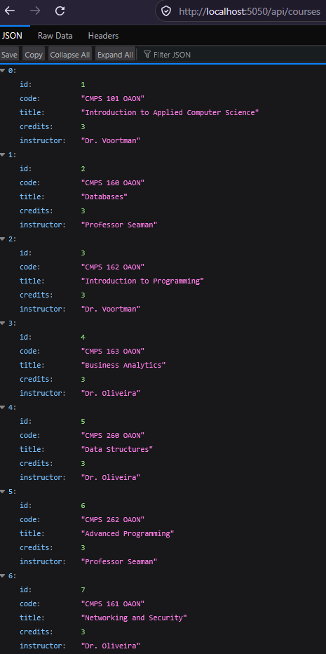
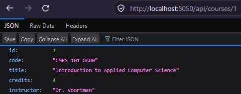
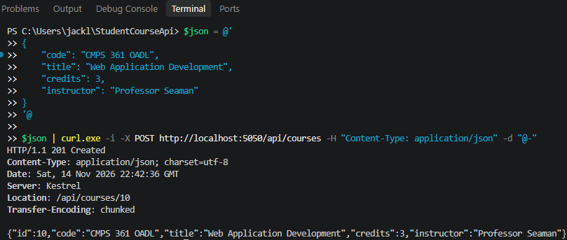
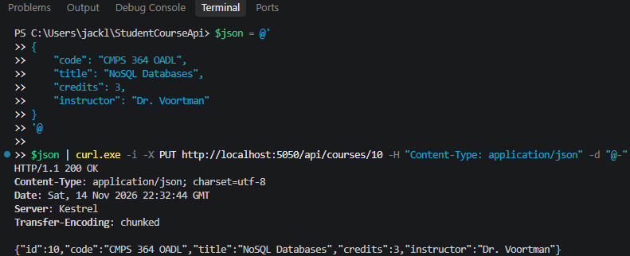
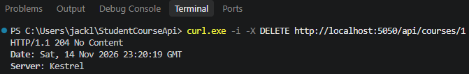
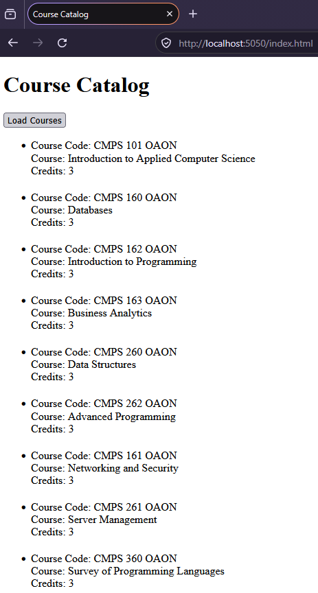

# Student Course API

A REST API built with C# and ASP.NET Core for managing a collection of university courses. Supports creating, retrieving, updating, and deleting courses, with a simple HTML/JavaScript frontend for displaying the course catalog.

## Prerequisites

- .NET 10.0 SDK
- Visual Studio Code or Visual Studio
- PowerShell (for the example cURL commands)

## Running the Application

1. Clone the repository:

   ```bash
   git clone https://github.com/jackloomis/CMPS360-CSharp-Module4
   ```

2. Navigate to the project directory:

   ```bash
   cd CMPS360-CSharp-Module4
   ```

3. Run the application:

   ```bash
   dotnet run --urls http://localhost:5050
   ```

4. Open the course catalog in your browser using the local application address.

   API base URL: `http://localhost:5050`

## API Routes

| HTTP Method | Endpoint | Description |
|---|---|---|
| GET | `/api/courses` | Retrieve all courses |
| GET | `/api/courses/{id}` | Retrieve a course by ID |
| POST | `/api/courses` | Create a new course |
| PUT | `/api/courses/{id}` | Update an existing course |
| DELETE | `/api/courses/{id}` | Delete a course |

### Sample JSON

The following JSON structure is used when creating or updating a course:

```json
{
    "code": "CMPS 360 OAON",
    "title": "Survey of Programming Languages",
    "credits": 3,
    "instructor": "Professor Seaman"
}
```

The course ID is generated automatically when a new course is created.

### Example Requests

**GET - Retrieve all courses**

```bash
curl.exe -i -X GET http://localhost:5050/api/courses
```



**GET - Retrieve a specific course**

```bash
curl.exe -i -X GET http://localhost:5050/api/courses/1
```



**POST - Create a course**

```bash
$json = @'
{
    "code": "CMPS 361 OADL",
    "title": "Web Application Development",
    "credits": 3,
    "instructor": "Professor Seaman"
}
'@

$json | curl.exe -i -X POST http://localhost:5050/api/courses -H "Content-Type: application/json" -d "@-"
```



**PUT - Update a course**

```bash
$json = @'
{
    "code": "CMPS 364 OADL",
    "title": "NoSQL Databases",
    "credits": 3,
    "instructor": "Dr. Voortman"
}
'@

$json | curl.exe -i -X PUT http://localhost:5050/api/courses/10 -H "Content-Type: application/json" -d "@-"
```



**DELETE - Delete a course**

```bash
curl.exe -i -X DELETE http://localhost:5050/api/courses/1
```



## Validation

- Course code, title, and instructor cannot be empty.
- Credit values must be between 1 and 6.
- Course IDs are generated automatically.
- Requests referencing nonexistent course IDs return a 404 response.

## Frontend Implementation



## Notes

There is currently no database implementation so changes are not persistent and will be lost when the application restarts.